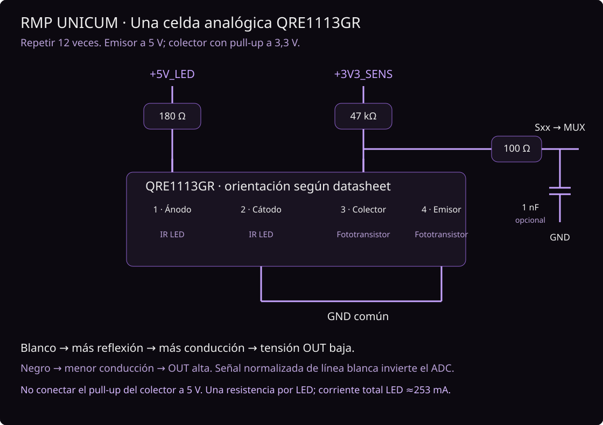

# Electrónica y barra analógica

## Una celda QRE1113GR, repetir doce veces

Pinout de onsemi: **1 ánodo, 2 cátodo, 3 colector, 4 emisor**. Revisar la vista
y orientación del encapsulado en el datasheet; no deducir el pin 1 por una foto.

| Componente/terminal | Conexión |
| --- | --- |
| +5V_LED | Resistencia de 180 Ω, mínimo 1/8 W, una por LED |
| Extremo de resistencia 180 Ω | QRE pin 1, ánodo |
| QRE pin 2, cátodo | GND |
| +3V3_SENS | Resistencia de 47 kΩ, una por receptor |
| Extremo de resistencia 47 kΩ | QRE pin 3, colector: nodo OUT |
| QRE pin 4, emisor | GND |
| OUT | Resistencia serie de 100 Ω hacia señal Sxx/ADC |
| Sxx | Capacitor opcional 1 nF a GND, junto a entrada ADC |

Este es el mismo principio de salida analógica por fototransistor que la QTR-8A,
adaptado a doce QRE1113GR y lógica de 3,3 V. **No es una copia de su circuito de
alimentación LED:** aquí cada emisor tiene su resistencia independiente a 5 V.
Emisores siempre encendidos; no hay control individual ni resta de luz ambiente.

Con Vf típica de 1,2 V: I_LED≈(5−1,2)/180≈21 mA por sensor, ≈253 mA para doce.
Potencia en cada resistencia ≈0,080 W; usar 1/8 W o más y considerar derating.
La corriente real depende de Vf/tolerancias. No alimentar los 12 LED desde un GPIO
ni desde el regulador 3V3 de una placa genérica. Si se cambia tensión, recalcular
resistencias. No poner varios LED en paralelo compartiendo una sola resistencia.

Mayor reflexión en blanco → más conducción → OUT baja; negro → OUT alta.
El pull-up a 3,3 V limita la salida a la lógica del ESP32. **No llevar el pull-up
a 5 V** aunque el LED use 5 V. ADC a 12 bits y atenuación 11 dB: la escala de
conversión del ESP32 clásico puede saturar antes de 3,3 V (~3,1 V), por lo que
4095 no implica medir con precisión 3,3 V. Para seguimiento se calibra cada canal.

47 kΩ es valor inicial inspirado en QTR-8A; validar contraste/ruido con QRE,
altura y piso reales. Si blanco y negro saturan ambos o tienen poco contraste,
ajustar altura y probar 10–22 kΩ. Capacitor 1 nF con 47 kΩ produce τ≈47 µs;
no instalar 100 nF en cada señal sin estudiar la respuesta temporal.

## Mecánica de barra (propuesta)

- Línea recta de 12 sensores; paso inicial **8 mm**, 88 mm entre S01/S12.
- Ancho orientativo de PCB 96–100 mm, a confirmar por encapsulado y montaje.
- Caras ópticas orientadas al piso, todas a la misma altura. Comenzar cerca de
  2–3 mm y medir contraste; no trasladar automáticamente alturas recomendadas
  para los sensores ópticos distintos de una QTR comercial.
- Serigrafía S01..S12 de izquierda a derecha según dirección de avance; flecha
  frontal en la base. Barra delante del eje, distancia a definir con chasis.
- Separar óptica y pistas analógicas del driver y cables de motores; masa continua
  en barra. Mantener zona de antena del ESP32 libre según su fabricante.

No se fijó geometría de fabricación: faltan dimensiones de ruedas/chasis y placa.

## Batería LiPo 2S y motores Pololu 6 V

Una 2S convencional tiene **7,4 V nominal y 8,4 V cargada**. No es un rail de 6 V.
Base propuesta: batería → protección/fusible e interruptor → regulador **6 V
para VM** y regulador **5 V para la placa ESP32 y emisores**. La salida 3V3 de la
placa alimenta receptores y VCC del TB6612, de consumo pequeño.

Elegir corriente del regulador de motores por los dos motores y sus arranques,
incluida capacidad ante transitorios/regeneración y disipación. **Falta el modelo
Pololu exacto**: muchos HP pueden superar la capacidad del TB6612 al bloquearse.
No dar por compatible el driver únicamente porque el motor sea de 6 V.

Como diseño base, no alimentar esos motores directamente a 8,4 V confiando en
un límite de PWM: reduce tensión media pero los pulsos siguen siendo de 8,4 V.
No hay medida de corriente ni undervoltage LiPo por firmware; usar protección/
alarma externa adecuada. La energía de frenado vuelve al rail VM; elegir etapa
de alimentación que la tolere, desacoplar y medir picos bajo carga.

| Rail | Destino | Criterio |
| --- | --- | --- |
| LiPo 2S | Entrada reguladores | 8,4 V máxima, protección de batería |
| 6 V regulados | TB6612 VM / motores | Dimensionar por corriente de motores y límites driver |
| 5 V regulados | Pin 5V/VIN de **placa de desarrollo** y LED de barra | Propuesta 2 A con margen; verificar pin 5 V real |
| 3,3 V | TB6612 VCC, receptores, botones | Nunca alimentar módulo WROOM desnudo a 5 V |
| GND | Todo | Retornos motores separados de señales hasta punto común |

USB y alimentación externa: revisar circuito de la placa concreta antes de
conectarlos simultáneamente. Si se usa módulo WROOM sin placa de desarrollo,
se necesita regulador 3V3, EN/reset y circuito de programación propios.

## Driver, ruido y componentes auxiliares

TB6612 VCC=3,3 V; VM=6 V en la propuesta. Rango recomendado VM=2,5..13,5 V,
VCC=2,7..5,5 V. No confundir máximo absoluto con condición continua de diseño:
el datasheet actual especifica 1,0 A en rango operativo sin PWM con VM≥4,5 V;
1,2 A figura en máximos absolutos y 3,2 A es pico de un único pulso de 10 ms.
Evaluar térmica y corriente real del módulo, sin usar el pico como corriente de trabajo.

- Junto al TB6612: 100 nF cerámico + 10 µF en VCC; 100 nF + 10 µF en VM
  según aplicación del fabricante. Agregar 470 µF en VM como reserva inicial,
  tensión ≥16 V; dimensionar según transitorios reales.
- Barra: 100 nF + 10 µF en cada rail (5 V y 3V3), cerca del conector.
- Motores: 100 nF cerámico entre bornes como punto inicial, cables cortos/trenzados.
- PWMA/PWMB: pull-down de 10 kΩ a GND; STBY: pull-down de 10 kΩ y
  jumper/interruptor a 3V3. Abrirlo deshabilita el driver independientemente de software.
- Botones: un pull-up de 10 kΩ a 3V3 cada uno; GPIO5/15 sueltos al reset.
- Motor driver ya tiene caminos de recirculación. No poner un diodo único en
  paralelo con un motor que se va a invertir mediante puente H.

La lista [BOM](../hardware/BOM.csv) es para este diseño lógico. Si se compra
breakout TB6612, descontar los capacitores que ya incluya y verificar su esquema.
